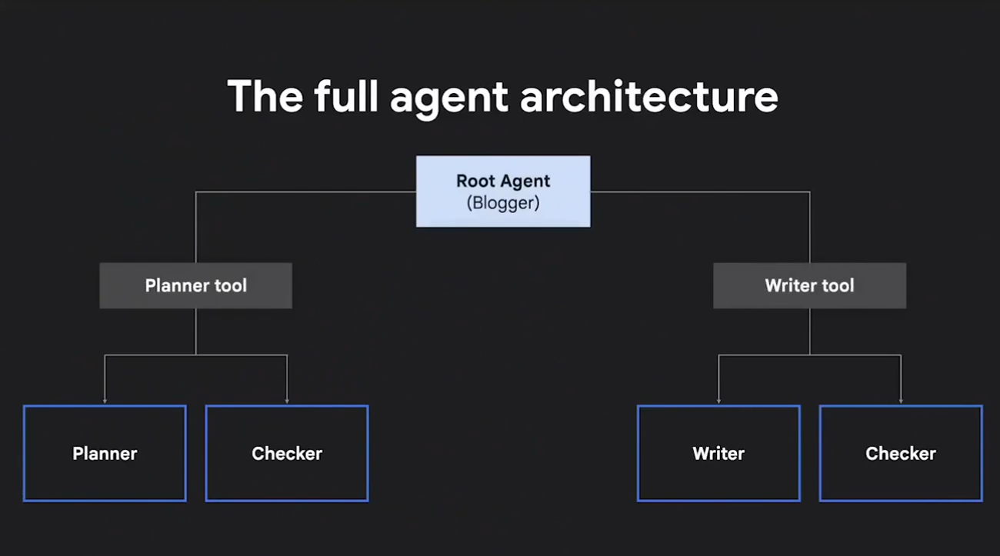
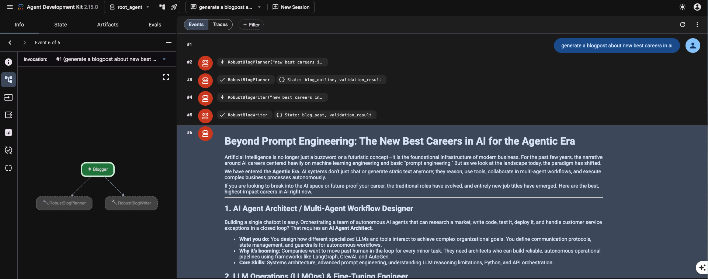

## Building blog writing agent

Goal:
Build a blog-writing agent with Google Agent Development Kit (ADK)

```
1) User gives a topic
2) it generates structured outline
3) Turn the outline to full blog post
4) Suggest alternative titles and hooks
```




### Agent foundation: reasoning and acting


```
Reason(Internal thinking)
|
Act (API call)
|
Observe (Data results)
|
Adjust/Decide (Looping back to reason)
```

### Agents behavior patterns

1- **Sequential agents** --> (predicatable & rigid)

- For simple predictable flows

2- **Reactive agents** --> (Decides in the moment/flexible)

- For dynamic flows

3- **Deliberate/planning agents** (Plan ahead, then execute)

- For multi-steps goals with dependencies flows

### Run the project locally

1- uv sync

2- uv run adk web

3- Visit http://127.0.0.1:8000

4- Ask the topic you want a blogpost for

Example:



