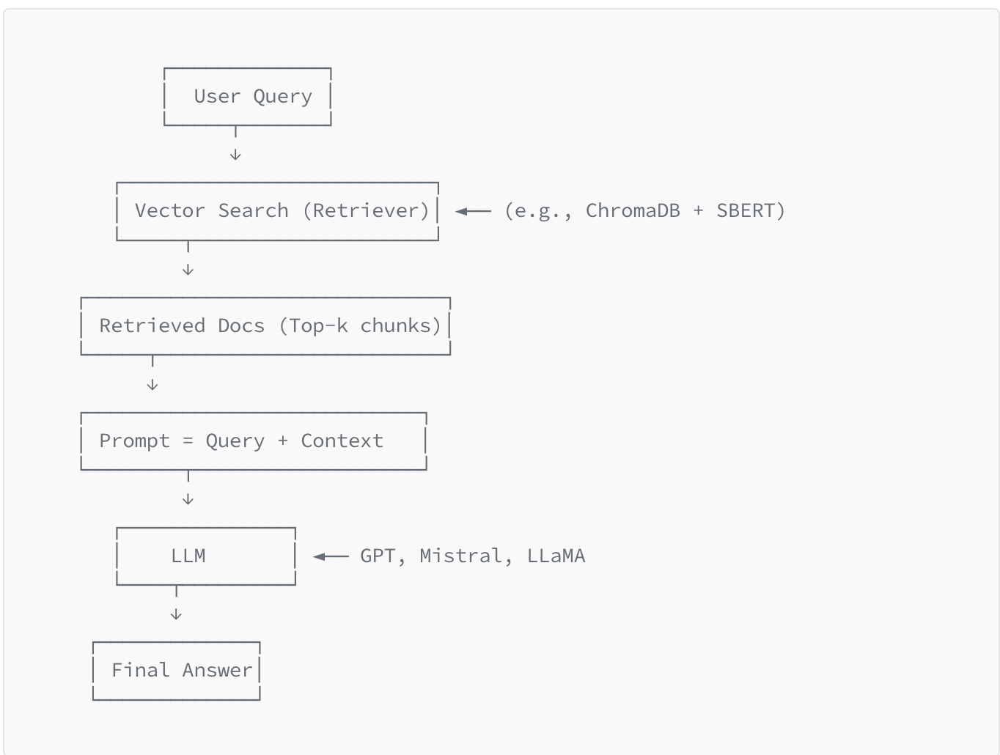

Simple `RAG`

Architecture Overview
The RAG pipeline has 3 main stages:

Document Ingestion — Load and chunk your data
Embedding + Retrieval — Convert chunks into vectors and store for similarity search
Augmented Generation — Fetch relevant chunks and pass them to the LLM for response

